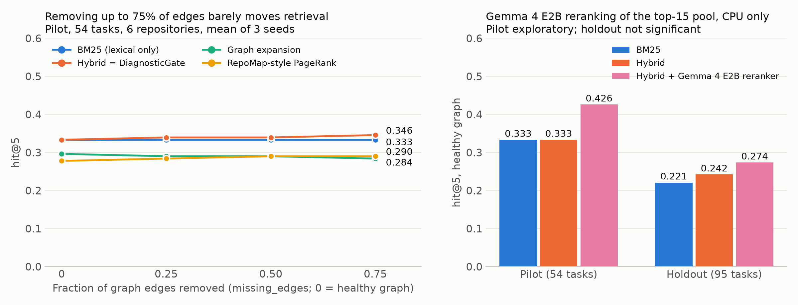

# GraphFaultBench: A Robustness Benchmark for Code-Graph-Guided Retrieval

**Subtitle:** Controlled corruption of code dependency graphs for issue localisation, with a local Gemma 4 E2B reranker

**Status:** the Kaggle Writeup text as submitted on 12 November 2026. Three phrases that name individual Loc-Bench tasks in the Writeup are replaced here by counts and repository names; no result is changed. The previous version (29 October 2026) is `submission/REVISED_PAPER.md`.

## Abstract

Small local models such as Gemma 4 depend on retrieval to decide which few functions of a large repository reach their limited context. Code-localisation agents increasingly combine repository dependency graphs with lexical retrieval, yet a statically built graph can be incomplete or stale, and a bounded search found no study that degrades the graph at controlled severity and measures the effect on issue-to-code retrieval. I present GraphFaultBench, an open resource that applies deterministic, severity-graduated corruption to code graphs of real GitHub repositories and scores retrieval policies on Loc-Bench tasks. Three findings follow. First, on healthy graphs a hybrid of graph and lexical scores and lexical-only BM25 each solve 18 of 54 pilot tasks, so the graph gave no measurable benefit to lose, and removing up to 75% of edges barely moves hit@5. Second, a transparent fallback gate is identical to the fixed hybrid on all 540 unique task–condition pairs under edge corruption, because by construction it cannot register it; under node removal it responds without a reliable accuracy gain. A pre-registered (not strictly blind) holdout on six further repositories (95 tasks) shows the same pattern. Third, a local, CPU-only Gemma 4 E2B reranker raised hit@5 from 0.333 to 0.398 on the pilot tasks (exploratory), and a pre-registered holdout showed the same direction (4 gains, 1 loss) without significance. I treat the harness as the contribution and report every adaptive variant as negative or inconclusive.

## Introduction

An offline coding agent cannot read a whole repository; a retrieval step chooses what it sees. LocAgent [1] represents a repository as a heterogeneous graph of files, classes, functions and dependencies, and reports that multi-hop graph search improves localisation over lexical retrieval.

Such results assume an accurate, reasonably complete graph, but static analysis can fail to resolve a call target and an index can be stale. My research question, registered before any pilot evidence:

*How does issue-to-code localisation degrade under controlled changes to the accuracy and completeness of a repository graph, and can a transparent fallback policy improve reliability with bounded computation?*

I registered three hypotheses: **H1**, graph-dependent ranking loses more accuracy than lexical retrieval as corruption increases; **H2**, an uncertainty-aware hybrid fallback reduces that decline; **H3**, the effect varies by issue category and graph topology. The evidence is mixed-to-negative for H1 and H2 and does not address H3, so I lead with the benchmark.

The contributions are: (1) a reusable harness with five seeded corruption operators, per-run manifests and repository-clustered exact intervals; (2) a pilot and a pre-registered holdout across twelve repositories; (3) a grammar-constrained Gemma 4 E2B reranker evaluated on the same tasks, with no GPU, fine-tuning or paid API.

## Related Work

**Graph-aided localisation.** LocAgent [1] (ACL 2025), RepoGraph [6] (ICLR 2025), CoSIL [7], SpIDER [8], ARISE [3] and RepoAtlas [5] report gains from structural information; none of the full texts searched degrades the input graph at controlled severity. CoSIL's ablation removes its module call graph, lowering function-level Top-1 from 0.430 to 0.383; SpIDER reports larger gains once call edges are explored.

**Robustness and fallback.** AgentNoiseBench [4] injects noise into general tool-using-agent benchmarks, reporting an average accuracy drop of 20.8%, but includes no code-localisation domain that I found. Agent Retrieval Bench [2] reports that abstention thresholds calibrated on counterfactual controls did not improve selective success on natural no-gold cases — an analogy to my finding that `DiagnosticGate`'s thresholds did not transfer across corruption classes. Falling back from a graph to text when graph support is weak has also been proposed for knowledge-graph question answering [9], so the gate is not a new idea. My search was bounded (web searches and citation-following), so it cannot establish that no prior work exists.

**Dataset.** Loc-Bench V1 (`czlll/Loc-Bench_V1`), introduced with LocAgent, provides 560 GitHub-issue rows with gold `edit_functions` labels; its card states no licence, so I do not redistribute it.

## Methods and Experiments

### Benchmark design

Five seeded corruption operators each return a corrupted graph and a manifest. Severity is a fraction of edges (nodes for `node_omission`).

| Operator | Effect |
|---|---|
| `missing_edges` | removes a fraction of edges uniformly within each edge type |
| `high_centrality_edges` | removes edges with the largest endpoint-degree sum, a cheap centrality proxy; the seed only breaks ties |
| `stale_rewire` | redirects edge targets to a random node of the same kind (self-loops possible; achieved fraction can fall below nominal) |
| `stale_symbol_refs` | replaces an edge target with a dangling identifier |
| `node_omission` | hides nodes and their edges, leaving gold labels untouched; a hidden gold answer is detected separately from a ranking miss |

For every policy except `repomap`, `stale_symbol_refs` yields rankings identical to deleting the same edges (checked at three severities), so it is not an independent stressor for them.

I score six policies: `bm25`; `graph_expansion` (one-hop expansion from the top three BM25 anchors); `fixed_hybrid` (0.5 normalised BM25 plus 0.5 normalised graph score); `repomap` (my PageRank reimplementation of aider's RepoMap idea, not the tool); `DiagnosticGate`; `WeightedDiagnosticGate`. The gate uses `node_coverage` (nodes present over a reference count), `anchor_confidence` (normalised top BM25 score) and `isolated_node_rate` (fraction of nodes with no edge). Against thresholds fixed during development, never fitted to evaluation data (`coverage_floor = 0.6`, `isolated_ceiling = 0.5`, `anchor_floor = 0.1`), it selects `hybrid`, `lexical_only` or `abstain`. **The reference count is the healthy graph's node count for the same snapshot**, so coverage equals one minus the omission severity exactly; a deployed gate would need a prior snapshot. `WeightedDiagnosticGate` keeps the abstain rule but weights `1 − 0.5 × min(node_coverage, 1 − isolated_node_rate)`; abstention never activated in any reported evaluation.

**Defect and post hoc correction.** My `repomap` PageRank graph included all edge endpoints, so dangling identifiers became pseudo-nodes able to occupy ranks. I re-ran only `repomap` under `stale_symbol_refs` with non-node endpoints excluded (486 pilot, 190 holdout invocations; the uncorrected variant reproduced the stored hit@5 exactly). Pseudo-nodes had held a top-5 place in up to 158 of 162 pilot invocations, yet hit@5 moved little: pilot 0.284 → 0.290, 0.290 and 0.296 at severities 0.25, 0.5 and 0.75; holdout 0.200 → 0.200 and 0.211. Both sets of numbers are retained (`results/analysis/repomap_correction.json`).

Loc-Bench V1 rows are grouped by commit; a graph is built from a commit-pinned snapshot with heuristic, name-based call resolution, and gold labels are resolved against it. Retrievers see only `problem_statement`. A hash split into development (20%) and evaluation sets preceded any threshold examination. Metrics are `hit_at_k` (k ∈ {1,3,5}), `strict_acc_at_5` and mean reciprocal rank.

### Statistical design

Intervals resample whole repositories with replacement and take the row-pooled mean (or paired difference). With six repositories there are 6^6 = 46,656 equally likely draws, enumerated exactly at the 2.5th and 97.5th percentiles; the stored 2,000-draw intervals differ from the exact values by at most 0.016 (`results/analysis/exact_ci_table.json` lists both). Six clusters of very unequal size (evaluation tasks: dask 18, mypy 11, prefect 11, scipy 7, aiohttp 5, numpy 2) make the intervals descriptive, not calibrated; pilot analyses are exploratory (no multiplicity adjustment or equivalence test), so "no difference detected" never means equivalence.

### Experimental setup

The pilot used `python/mypy`, `dask/dask`, `PrefectHQ/prefect`, `numpy/numpy`, `scipy/scipy` and `aio-libs/aiohttp` at 58 commit-pinned snapshots, seeds `[1,2,3]`, severities `[0.0, 0.25, 0.5, 0.75]`, with the configuration registered beforehand and no GPU, fine-tuning or paid API. The pilot (8,100 rows = 5 policies × 1,620) ran on CPU in 69 and 53 minutes on two machines. Of 65 attempted tasks, one (a numpy task) failed gold-label resolution, leaving 64: 10 development, 54 evaluation.

### Results

*Figure 1. Left: pilot hit@5 against the fraction of edges removed by `missing_edges`. Right: healthy-graph hit@5 with and without the Gemma 4 E2B reranker (pilot exploratory; holdout not significant).*

**Repeated observations.** The 1,620 invocations per policy are 54 tasks × 10 conditions × 3 seeds. The healthy graph is identical across seeds, and of 2,430 corrupted task–condition–policy cells only 56 change hit@5 across seeds. The effective sample is 540 unique task–condition pairs per policy across six repositories.

**Healthy-graph headroom.** `fixed_hybrid` and `bm25` each solve 18 of 54 evaluation tasks (hit@5 = 0.333) but not the same ones: `fixed_hybrid` alone solves one dask task and `bm25` alone solves one prefect task. Paired difference 0.000, exact repository-clustered 95% CI [−0.057, 0.041]; leaving out dask gives −0.028 and leaving out prefect +0.023, so the sign rests on single tasks. `graph_expansion` (16/54) and `repomap` (15/54) score lower. The graph gives no measurable localisation gain here, and H1 is largely untestable: a method cannot lose a benefit it lacks.

**Edge-only corruption.** Over 1,620 invocations per method, mean hit@5 is 0.333 for `bm25` and 0.338 for `fixed_hybrid` and `DiagnosticGate`; the gate always chose `hybrid`, equalling `fixed_hybrid` on all 540 unique pairs. This follows from the design: edge-only operators leave the node set and node text unchanged, so `node_coverage` and `anchor_confidence` stay at 1.0, and `isolated_node_rate` (0.003 healthy; mean 0.360 at severity 0.75 under `missing_edges`; max 0.423) never reaches 0.5. This is not evidence that the gate "matches" the hybrid on real faults.

**Node omission.** On the 10 development tasks (120 rows), `node_coverage` falls to 0.500 at severity 0.5 and 0.250 at 0.75, switching 60 of 120 rows to `lexical_only`. On the 54 evaluation tasks (1,944 rows, unmodified thresholds) the gate is a step function — `hybrid` at 0.0–0.25, `lexical_only` at 0.5–0.75 — equalling `fixed_hybrid` then `bm25`. Omission hides the gold answer in 0%, 37.7%, 59.3% and 81.5% of tasks by severity; only gold-visible rows are scored.

| Severity | Gold-visible rows | `bm25` / `DiagnosticGate` hit@5 | `fixed_hybrid` hit@5 |
|---|---|---|---|
| 0.50 | 66 | 0.364 [0.14, 0.61] | 0.394 [0.17, 0.64] |
| 0.75 | 30 | 0.433 [0.21, 0.70] | 0.400 [0.16, 0.68] |

The abandoned policy is higher at severity 0.5 and lower at 0.75; with wide overlap, the gate shows no reliable advantage. `WeightedDiagnosticGate` (648 rows) ties `DiagnosticGate` at severities 0.0, 0.5 and 0.75; at 0.25 its hit@5 is 0.396 (n = 101) against 0.426 for `fixed_hybrid` and 0.376 for `bm25`: inconclusive.

**`stale_rewire`.** Run afterwards (3,240 rows), `bm25`, `fixed_hybrid` and the gate all score 0.333 at every severity; the gate chose `hybrid` on all 648 rows. `graph_expansion` moves from 0.296 to 0.278, `repomap` from 0.278 to 0.284, treated as noise.

**Holdout.** Because the pilot's development and evaluation tasks share repositories, I registered a holdout on six repositories absent from every earlier experiment (sqlglot, yt-dlp, Django, moto, sympy, matplotlib) on 22 October 2026. **It was not strictly blind:** during the pilot's repository widening I inspected graph sizes for several candidates and replaced sympy in the pilot for graph size; how far I inspected moto and matplotlib, and whether any retrieval was run on them, is undocumented. Gate thresholds predate every holdout run. The design used 95 tasks, five policies, four edge operators at severities 0.5 and 0.75 plus one healthy condition, one seed: 95 × 9 × 5 = 4,275 rows, 855 gate rows. On healthy graphs `bm25` scores 0.221 (21/95) and `fixed_hybrid` 0.242 (23/95); difference +0.021, exact CI [0.000, 0.045], entirely from Django (12 against 14 of 35), the other five tied; 33.5% of resampled differences are exactly zero, so the lower bound is weak evidence. Two repositories (yt-dlp, 27 tasks; moto, six) give no hit for either method (floor effect). `DiagnosticGate` equals `fixed_hybrid` on all 855 gate rows.

**Gemma 4 E2B reranking.** A local CPU-only Gemma 4 E2B (4-bit GGUF) reranked `fixed_hybrid`'s top-15 candidates for the 54 pilot evaluation tasks at severities 0.0 and 0.5 (`missing_edges`, seed 1; 108 calls). An earlier unconstrained version parsed cleanly in only 14 of 30 calls and did not change hit@5; the revised version numbers the candidates and constrains decoding by grammar to five numbers, giving 83 of 108 valid distinct ids (malformed outputs complete in `fixed_hybrid` order). Hit@5 is 43/108 (0.398) against 36/108 (0.333) for `fixed_hybrid` and `bm25`: difference +0.065, exact CI [0.035, 0.097]; seven calls (six tasks) gained, none reversed — +0.093 [0.047, 0.146] on healthy graphs, +0.037 [0.000, 0.079] at severity 0.5. By repository, gains are mypy 1/22, dask 2/36, prefect 2/22, scipy 2/14, none in numpy (4) or aiohttp (10); the gain stays positive leaving out any one repository (0.053–0.071). The pool contains the gold function in 45/108 calls (41.7%), the ceiling for any reranker. This is promising but exploratory, not held out: the two severities reuse the same tasks, all 15 earlier-demonstration tasks recur here (34 against 29 on the other 39), the prompt was revised after that failed demonstration, and it rests on one small model and prompt.

**Gemma 4 E2B reranking: holdout.** Pre-registration found only 4 of the 95 holdout tasks have gold inside the top-15 pool but outside `fixed_hybrid`'s top 5 (6 at top-30), too few to power a confirmatory test; the design was frozen as estimation-only. The frozen v2 model, prompt, grammar and pool reranked all 95 healthy-graph holdout tasks, one call each; rescoring from rebuilt pools matched stored output exactly. Hit@5 rose to 26/95 (0.274) from `fixed_hybrid`'s 23/95 (0.242) and `bm25`'s 21/95 (0.221): 4 gains, 1 loss; exact CI [0.000, 0.054], sign test p = 0.375. The effect concentrates in Django (3 gains, 1 loss of 35) and sqlglot (1 gain of 15); the two floor-effect repositories (33 tasks) show none. As pre-specified, this reads as consistent with, but not evidence for, a gain on unseen repositories.

### Discussion

I do not find support for the idea that cheap diagnostic signals can tell a system when to trust a graph: two of three signals cannot register edge-only corruption; where the gate does respond, accuracy did not reliably improve; and with no graph benefit at baseline, there was no advantage to protect. For a small local agent, the practical reading is that headroom lay in ordering a candidate pool, and above all in the pool's recall (41.7% in the pilot), rather than in the graph signal of these simple policies. A post hoc check across all 12 repositories found no node-count, edge-count, density or unresolved-call property distinguishing gain from non-gain repositories beyond the trivial zero-pool-recall floor (Spearman ρ ≤ 0.34 against net gain; `results/analysis/graph_property_headroom.json`).

The harness is not tied to these policies: any retriever that takes an issue text and a graph, including an agentic multi-hop searcher such as LocAgent, can be scored under the same operators. I did not run such agents, so the results describe simple graph policies only.

### Limitations

The benchmark measures retrieval given a graph assumed correct before corruption; it does not measure graph-builder accuracy (no ground-truth call graph was available), and correspondence of any operator to naturally occurring faults is unvalidated. Six uneven repository clusters, one holdout seed, edge-only holdout operators and two floor-effect repositories limit the data. The gate's abstention branch is untested on data and its thresholds were not varied. Only same-snapshot Python imports are represented, so hit rates are not comparable with work whose queries include hints or patches. I fixed a duplicate-node-identifier bug (`@typing.overload` stubs) before any reported run.

### Code and verification

Code, tests, configurations and stored analysis files are public at `github.com/MdTanjilIslamBappi/graphfaultbench` (Project Link). `uv run pytest -q` runs the unit tests and the synthetic validation on CPU in seconds. Because Loc-Bench V1 states no licence, the release excludes the dataset and per-task outputs: the empirical tables are stored as-run records, and re-running them requires fetching Loc-Bench V1 and the repository snapshots (`submission/REPRODUCIBILITY_GUIDE.md`).

## Conclusion

GraphFaultBench applies deterministic, severity-graduated, auditable corruption to code dependency graphs and evaluates retrieval policies on real repositories and tasks (64 of 65 pilot tasks resolved, all 95 holdout tasks); I treat it as the primary contribution. Neither adaptive fallback is a validated reliability mechanism. The pre-registered but not strictly blind holdout again finds almost no healthy-graph headroom (two tasks, one repository) and a gate identical to the fixed hybrid. A grammar-constrained local Gemma 4 E2B reranker shows a modest, exploratory pilot gain, repeated in direction but not significance on holdout. I did not address H3.

## Acknowledgements

AI-assisted tooling supported implementation and result checking against primary files.

## References

1. Z. Chen, R. Tang, G. Deng, F. Wu, J. Wu, Z. Jiang, V. Prasanna, A. Cohan, and X. Wang, "LocAgent: Graph-Guided LLM Agents for Code Localization," in *Proc. 63rd Annu. Meeting Assoc. Comput. Linguistics (Vol. 1: Long Papers)*, Vienna, Austria, 2025, pp. 8697–8727, doi: 10.18653/v1/2025.acl-long.426. arXiv:2503.09089.
2. B. Qin and Y. Xie, "Agent Retrieval Bench: Evaluating Repository Context Retrieval for Coding Agents," arXiv:2607.24882, 2026.
3. S. Seddik, F. Seddik, A. Esmaeili, M. Sadatbenis, and F. Fard, "ARISE: A Repository-level Graph Representation and Toolset for Agentic Program Repair and Fault Localization," arXiv:2605.03117, 2026.
4. R. Wang, Y. Chen, Y. Wang, C. Wu, J. Fang, X. Cai, Q. Gu, H. Su, A. Zhang, X. Wang, X. Cai, and T.-S. Chua, "AgentNoiseBench: Benchmarking Robustness of Tool-Using LLM Agents Under Noisy Condition," arXiv:2602.11348, 2026.
5. Y. Zhang, H. Wang, J. Guo, H. Xia, Y. Chen, T. Chen, Z. Zhang, and J. Ye, "RepoAtlas: Guiding Coding Agents via Evolving Multimodal Repository Views," arXiv:2609.16936, 2026.
6. S. Ouyang, W. Yu, K. Ma, Z. Xiao, Z. Zhang, M. Jia, J. Han, H. Zhang, and D. Yu, "RepoGraph: Enhancing AI Software Engineering with Repository-level Code Graph," in *Proc. ICLR*, 2025. arXiv:2410.14684.
7. Z. Jiang, X. Ren, M. Yan, W. Jiang, Y. Li, and Z. Liu, "Issue Localization via LLM-Driven Iterative Code Graph Searching," arXiv:2503.22424 (v1: "CoSIL").
8. S. Chaudhari, R. T. Jacob, J. Cao, S. Rashid, M. Goswami, and C. Bock, "SpIDER: Spatially Informed Dense Embedding Retrieval for Software Issue Localization," arXiv:2512.16956 (v3).
9. Y. Ma, J. Xu, T. Wen, Q. Chen, J. Li, R. Wang, M. Li, S. Liang, and K. Qin, "Toward Robust GraphRAG: Mitigating Retrieval Drift and Hallucination from Imperfect Knowledge Graphs," arXiv:2603.14828, 2026.
